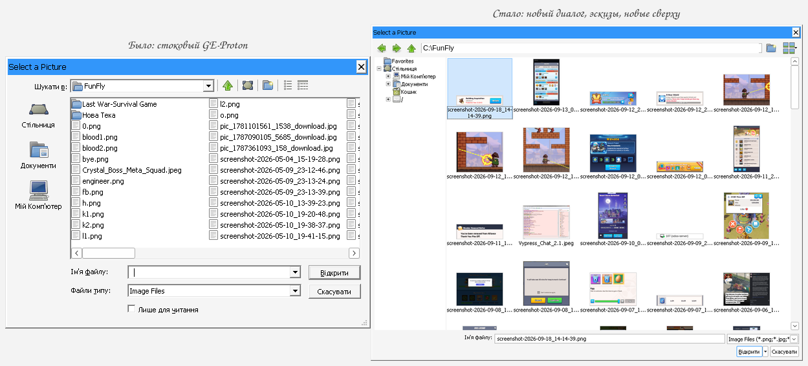

# wine-thumbs: a Windows-like file dialog for Wine

A patch series for Wine's `shell32` and `comdlg32`. Programs that call
`GetOpenFileName`/`GetSaveFileName` get the Vista-style dialog, as on Windows,
with image thumbnails, an address box, and a sort order and folder that are
remembered. It was written for a game running under GE-Proton whose "attach a
picture" dialog was a bare list of file names, but it works for any program.

These patches are not submitted upstream: Wine does not accept LLM-written
code, so they are kept here and rebased onto each new GE-Proton release.



## Current target

| | |
|---|---|
| Built and in daily use on | GE-Proton11-12 (Wine 11.0 + Valve + staging + GE) |
| Earlier GE releases built | GE-Proton11-6, 11-7, 11-9, 11-11 |
| Also applied cleanly (Sept 2026) | upstream Wine 11.17 and master at the time |

`scripts/apply.sh --check` tells you in a few seconds whether the series still
applies to a newer tree, and which patch breaks first.

## What it does

**The dialog**
- `GetOpenFileName`/`GetSaveFileName` show the item (`IFileDialog`) dialog, as
  Windows has done since Vista, unless the program customizes the dialog with
  a hook, a template or a help button. That includes multiple selection, the
  ANSI calls, the "Open as read-only" choice in the Open drop-down button, and
  `FNERR_BUFFERTOOSMALL`.
- An address box shows the current folder. Type a path there, absolute or
  relative to the current folder, and press Enter to go to it.
- New folder and View buttons (Thumbnails / List / Details).
- The dialog opens at the size you last gave it.
- It opens in the folder you last picked a file from. Windows 7 does this too
  when the program passes the same initial folder as the first time.

**Thumbnails**
- A Thumbnails view in both dialogs: the toolbar button in the classic one, the
  View button in the new one, and View > Thumbnails in the right-click menu.
- Previews are decoded on up to 4 low-priority background threads, so the
  dialog never freezes. What is on screen gets decoded first.
- Downscaling averages over the covered area. Wine's own WIC scaler only does
  nearest-neighbour, which turns screenshot text into noise. JPEG/TIFF EXIF
  rotation is applied, and small images are not enlarged.
- Every format Wine's WIC can decode works: PNG (8/16 bit, grey, palette,
  alpha), JPEG, BMP, GIF, TIFF, ICO, DDS, JPEG XR. The list comes from the
  installed decoders, so formats Wine adds later work without changes.
- Previews are cached per process (64 MB by default), so reopening is instant.
- Sizes follow the DPI: at 192 DPI with a per-monitor aware program, previews
  are 192 px.

**Sorting and menus**
- The sort order is remembered per folder, in every view. Sort by date once in
  a screenshots folder and it stays newest first.
- Right-click > Arrange Icons offers By Name / Type / Size / Date plus
  Ascending / Descending. Date and size start newest and biggest first, like
  Explorer, and names sort naturally ("2" before "10"). The details header shows
  the sort arrow.
- The right-click menu of the file list lost its View, Arrange Icons and New
  submenus in Wine: an id mix-up dropped them when the menu was merged. They are
  back, with the current view and sort marked.
- The classic dialog never showed which view button is active: its toolbar
  shares the control id of the Open button.

Settings, all optional, in the prefix registry:

| Key | Value | |
|---|---|---|
| `HKCU\Software\Wine\FileDialog` | `Classic` (DWORD 1) | keep the old dialog; also per program in `AppDefaults\<exe>\FileDialog` |
| `HKCU\Software\Wine\FileDialog` | `ViewMode` (DWORD, `FVM_*`) | written by the dialogs |
| `HKCU\Software\Wine\FileDialog` | `ItemDialogSize` | written by the new dialog |
| `HKCU\Software\Wine\FileDialog\FirstFolder` | per program | the first initial folder it passed |
| `HKCU\Software\Wine\Shell\FolderSort` | per folder | column, direction; the last 500 folders |
| `HKCU\Software\Wine\Thumbnails` | `Size` (DWORD, px at 96 DPI, 32 to 256) | default 96 |
| `HKCU\Software\Wine\Thumbnails` | `CacheSize` (DWORD, MB, 0 = none) | default 64 |

Debug output: `WINEDEBUG=+thumbnail,+commdlg`.

## The patches

`patches/series` lists them in the order they apply. Each one is a
`git format-patch` file whose commit message describes the change.

1. `shell32: Add a thumbnail view mode.` All the thumbnail logic is in the new
   `dlls/shell32/shlview_thumbs.c`. `shlview.c` only gets small hooks.
2. `shell32: Keep the view mode when the ExplorerBrowser navigates.`
3. `comdlg32: Send toolbar control messages to the toolbar.` Existing Wine bug:
   `IDC_TOOLBAR == IDOK`.
4. `comdlg32: Add a thumbnails view button and remember the view mode.`
5. `shell32: Fix the background menu and remember the sort order of each folder.`
   Persistence lives in `dlls/shell32/shlview_sort.c`.
6. `comdlg32: Use the item dialog for GetOpenFileName and GetSaveFileName.`
   The mapping lives in `dlls/comdlg32/filedlg_item.c`.
7. `comdlg32: Add an address box and New folder and View buttons to the item dialog.`

Menu and tooltip strings are translated for 33 of Wine's languages via
`translations/thumbnails.tsv`. `scripts/apply-translations.sh` appends them to
`po/*.po` at build time instead of patching the po files, so upstream changes
to those files never conflict. The new dialog's Open/read-only items and the
View tooltip reuse strings Wine already translates.

## Moving to a new Wine or GE-Proton version

1. Check whether the series applies. For a git tree, the check runs in a
   temporary worktree of the committed state; anything else is copied first.
   Your tree is not changed either way.

   ```bash
   scripts/apply.sh --check ~/src/wine                      # upstream Wine at HEAD
   scripts/apply.sh --check --base baseline src/ge-<tag>/wine   # a tree build.sh prepared
   ```

   It prints `ok` per patch, notes the ones that only went in with a 3-way
   merge, and stops at the first one that fails.

2. If one fails, apply for real in a git tree. Each patch becomes a commit with
   `git am`; on a conflict `git am -3` leaves the markers in place and
   `apply.sh` prints the commands to continue.

   ```bash
   scripts/apply.sh --no-po ~/src/wine
   # fix the conflict, then
   git -C ~/src/wine add <files> && git -C ~/src/wine am --continue
   ```

   For a GE-Proton release, the easiest tree is the one `scripts/build.sh`
   makes: run it once, let it fail, then fix the patches in `src/ge-<tag>/wine`
   on top of the `baseline` tag.

3. Write the fixed commits back to `patches/` and `patches/series`:

   ```bash
   scripts/export-patches.sh src/ge-<tag>/wine            # base: the "baseline" tag
   scripts/export-patches.sh ~/src/wine wine-11.0         # any other base commit
   ```

   Commit messages become the patch descriptions, so reword them in the Wine
   tree (`git rebase -i`) rather than in the `.patch` files.

## Building and installing into a Proton prefix

```bash
scripts/build.sh GE-Proton11-12   # build only, any GE tag (default: the installed one)
scripts/update.sh                 # build + install for the installed GE-Proton
```

`build.sh` reproduces GE's Wine tree exactly. It clones proton-ge-custom at the
tag with its `wine` and `wine-staging` submodules, then runs the "WINE PATCHING"
section of GE's own `protonprep-valve-staging.sh` through
`scripts/ge-prep-wine.sh`, the way GE's build runs it. That keeps everything
Valve, staging and GE changed in these DLLs. The result is committed and tagged
`baseline`. Every build then resets to `baseline`, applies the series with
`git am` (falling back to `patch -F3` for context drift), appends the
translations and builds only the two DLLs, for x86_64 and i386. The first build
of a new tag takes a few minutes, mostly cloning. Rebuilds take about 10 seconds.
Building needs what Wine's `configure` needs for PE DLLs: a MinGW (or clang)
cross compiler for i386 and x86_64. Most other features are disabled.

`install.sh` makes a copy of the installed GE-Proton (reflinked, so it costs no
space on btrfs or XFS) with the four patched DLLs in it, in
`$WINE_THUMBS_PROTON_DIR/<GE tag>-<patch hash>/`. Point Steam or your launcher
at that copy.

### Following GE-Proton updates automatically

`scripts/select-proton.sh` is meant to run from a game launcher before Proton
starts. It points a symlink (`$WINE_THUMBS_LINK`) at:

- the patched copy, if one exists for the installed GE-Proton and the current
  patch set;
- the stock GE-Proton otherwise, and it starts `scripts/update.sh --background`,
  which builds the patched copy at low priority and sends a desktop
  notification. The next game start picks it up.

So a package update of GE-Proton never leaves the game on an old Proton: it runs
stock for one session, then gets the patches back. The link path never changes,
so Proton does not redo the prefix's DLL links when it switches. Old copies are
deleted once no process runs from them and the link no longer points at them.
To go back to stock for good, point the link at the stock GE-Proton and stop
calling `select-proton.sh`.

If a new GE release breaks the patches, `update.sh` notifies that the build
failed and retries at most every 6 hours; the game keeps running on stock
GE-Proton. Rebase the patches as described above.

### Paths

All paths have defaults and can be changed with environment variables:

| Variable | Default | |
|---|---|---|
| `WINE_THUMBS_STOCK_PROTON` | `/usr/share/steam/compatibilitytools.d/proton-ge-custom` | the installed GE-Proton (`proton-ge-custom-bin` on Arch) |
| `WINE_THUMBS_PROTON_DIR` | `~/.local/share/lastwar/proton-thumbs` | where patched copies go |
| `WINE_THUMBS_LINK` | `~/.local/share/lastwar/proton-current` | the link `select-proton.sh` maintains |
| `WINE_THUMBS_SRC_DIR` | `src/` | GE sources, about 900 MB per release |
| `WINE_THUMBS_BUILD_DIR` | `build/` | Wine build trees |
| `WINE_THUMBS_OUT_DIR` | `out/` | built DLLs |
| `WINE_THUMBS_LOG_DIR` | `logs/` | `update.log` and per-build logs |
| `WINE_THUMBS_GE_REPO` | GloriousEggroll/proton-ge-custom on GitHub | |

`src/`, `build/`, `out/`, `logs/` and `runtime/` are regenerated and ignored by
git. `update.sh` deletes the trees of other GE releases after a successful
build.

## Tests

- `test/unit/run.sh [shlview_thumbs.c]`: the resampler against an exact
  area-average reference on 3000 random sizes. Max error 0.5, i.e. rounding
  only.
- `test/thumbtest.c` + `test/run-test.sh`: opens the real dialog headless
  (Wine null display driver), scripts it and saves PNG captures to `test/out/`.
  It can switch views, run context-menu commands, select, type a name and press
  Open, use the address box, click toolbar buttons, resize, and print the
  returned `OPENFILENAME` fields.

Setup, after `scripts/build.sh`:

```bash
test/setup-runtime.sh        # test copy of GE-Proton + headless prefix in runtime/
test/make-images.sh          # test image folders (ImageMagick)
test/build-test.sh           # thumbtest.exe; "i386" for thumbtest32.exe
test/run-test.sh 'wait:1500,menucmd:0x2d,wait:2000,shot:thumbs,type:rose.bmp,ok'
```

`run-test.sh` takes `--32`, `--itemdlg`, `--dpiaware`, `--save`, `--ansi`,
`--multi`, `--flags=`, `--defext=`, `--file=` and `--maxfile=`. The actions are
listed at the top of `thumbtest.c`. After changing the patches, rebuild and run
`test/install-test-dlls.sh`. The test scripts use the GE tag of the installed
GE-Proton, or `WINE_THUMBS_TAG`.

## Known limits

- Only the two DLLs are rebuilt. The scripts assume a GE-Proton install layout
  (`files/lib/wine/<arch>-windows/`); for plain Wine, apply the series and
  build Wine yourself.
- Programs that customize the classic dialog (hook, template, help button)
  keep the classic dialog, which gets thumbnails and the sort fixes but not the
  address box.
- Wine's classic file dialog leaks about 40 GDI handles per open, with or
  without these patches.
- The build scripts' desktop notifications are in Russian.

## License

The patches modify Wine and are under the same license as Wine, the GNU Lesser
General Public License 2.1 or later. The scripts and tests here are under the
same terms. See [LICENSE](LICENSE).
